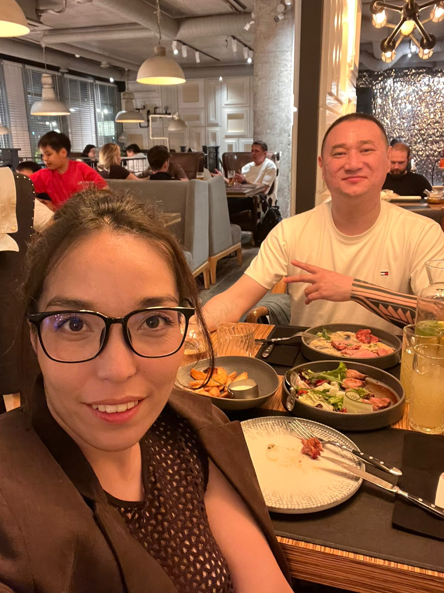

<html lang="ru">
<head>
<meta charset="UTF-8">
<meta name="viewport" content="width=device-width, initial-scale=1.0">
<meta name="theme-color" content="#080808">
<title>Нурбек | 38 лет</title>

</head>

<body>

<header class="hero">
   
  
  
A special evening

  <h1>Нурбек</h1>
  
38 ЛЕТ

  

  

    Один особенный вечер. 
    Близкие люди, приятная атмосфера 
    и повод собраться вместе.
  

  
Буду рад разделить этот день с тобой

  <a class="btn gold-button" href="#invitation">
    Открыть приглашение
  </a>
</header>

<section id="invitation" class="reveal">
  
You are invited

  

  <h2>Приглашаю тебя</h2>
  

    На празднование моего 38-летия. 
    Будет здорово провести этот вечер вместе!
  

  <h2 style="margin-top:45px">До встречи осталось</h2>
  

    
<strong id="days">00</strong>Дней

    
<strong id="hours">00</strong>Часов

    
<strong id="minutes">00</strong>Минут

    
<strong id="seconds">00</strong>Секунд

  

  

</section>

<section class="reveal">
  
Event details

  

  <h2>Детали вечера</h2>

  

    

      <b>ДАТА</b>
      Укажите дату праздника
    

    

      <b>ВРЕМЯ</b>
      Укажите время
    

    

      <b>АДРЕС</b>
      Укажите название заведения
    

    

      <b>МЕСТО</b>
      Укажите адрес мероприятия
    

  

  

    <a class="btn" id="mapButton" href="#"
       target="_blank" rel="noopener">
      Открыть карту
    </a>
    <a class="btn gold-button" id="rsvpButton" href="#">
      Подтвердить участие
    </a>
  

  

    Пожалуйста, сообщи, сможешь ли прийти.
  

</section>

<section class="reveal">
  

  <h2>До скорой встречи!</h2>
  
Нурбек · 38

</section>

<footer>WITH PLEASURE · NURBEK · 38</footer>

<button class="music" id="musicButton">♫</button>
        

<audio id="music" src="music.mp3" loop preload="auto"></audio>

</body>
</html>
